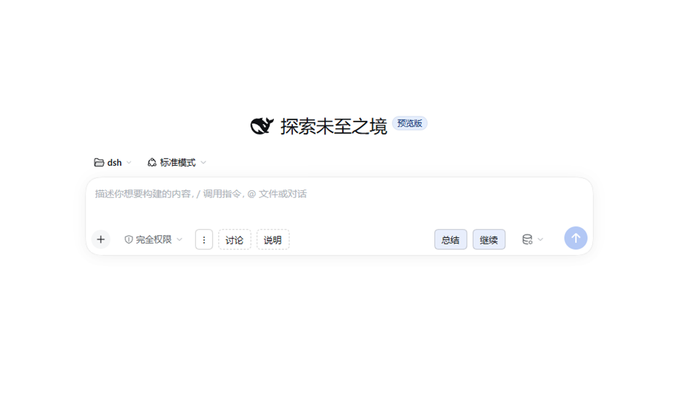
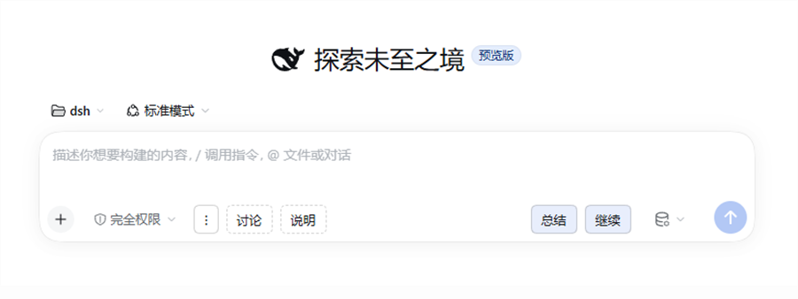
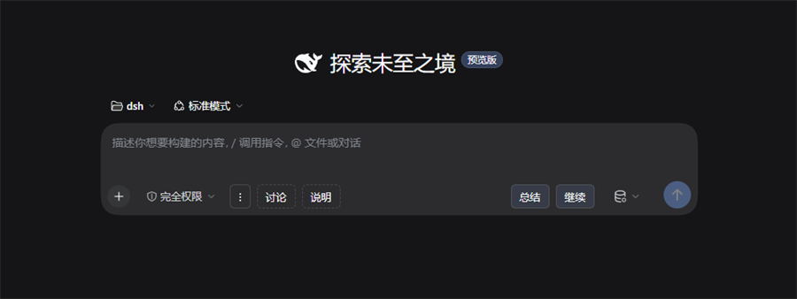
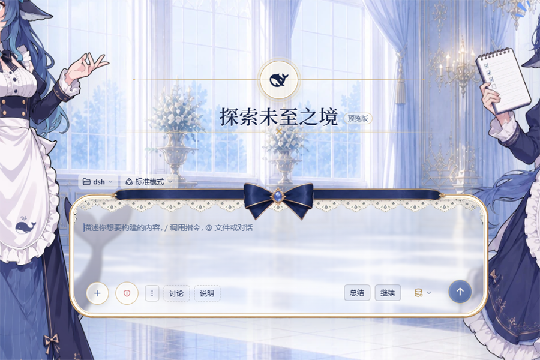
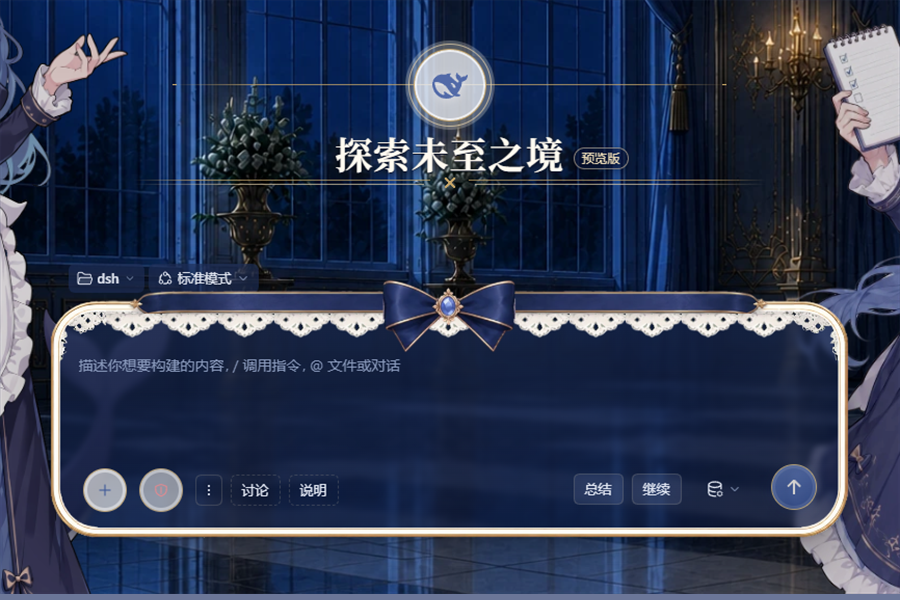
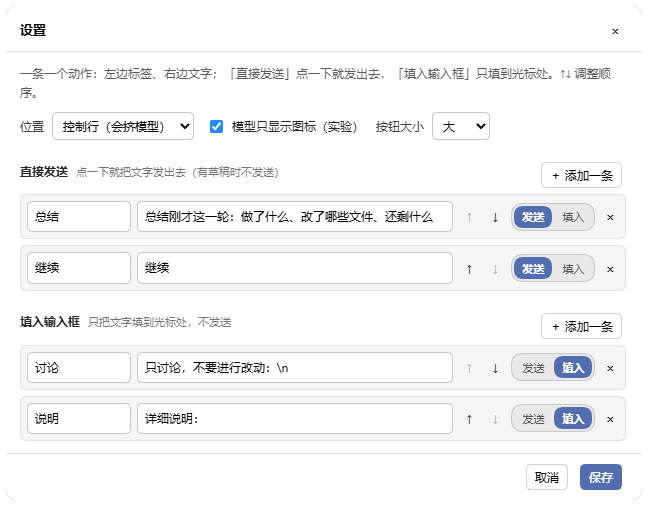

# dsh-button

在输入框下面加一排自定义按钮：**预设快捷输入**——把反复重打的常用语、提示词存成按钮，点一下填入草稿或直接发送；读到的内容还可以写成**引用块**（`{{引用选中}}`）。

按钮可调位置（左 / 右），外观按方式固定（发送 = 浅底、填入 = 描边），每侧超过 6 条自动收进可搜索的「⋯ 全部动作」。文字可以是固定的，也可以插**变量**点击时才读：`{{选中}}`、`{{上一条}}`、`{{AI回答}}`、`{{草稿}}`……

> 如果对您有帮助，请点个 ⭐ Star。有问题欢迎开 [Issue](https://github.com/xinming-chenniang/dsh-button/issues)，或者直接给我发邮件 xinming-chenniang@qq.com。



| 官方默认 · 浅色 | 官方默认 · 深色 |
|---|---|
|  |  |
| **示例皮肤 · 浅色** | **示例皮肤 · 深色** |
|  |  |

> 同一套按钮在官方默认和示例皮肤、浅色和深色下位置和行为都不变。
> 默认：左侧放「填入」类（描边），右侧放「发送」类（浅底实底）；位置能在设置里单独改，外观随方式固定。

## 安装

桌面端：**设置 → 插件 → 添加插件**，输入 `dsh-button`，装完重启 DSH。

或者用 CLI：

```powershell
dsh plugin --profile <你的profile> add dsh-button
```

从 GitHub 装也可以（钉 `v1.4.0`）：

```powershell
dsh plugin --profile <你的profile> add github:xinming-chenniang/dsh-button#v1.4.0
```

`#v1.4.0` 不要省：不钉版本会取仓库的 `main`，可能和已发布版本有差异。

`v1.3.1` / `v1.3.2` 只有 npm 包、没有对应的 tag 与 Release；要稳定版本走上面那条 npm 命令即可。

装完要重启 DSH。客户端插件是启动时加载的，刷新页面不会生效。

## 默认有什么

首次安装、还没有配置文件时，自带 5 个按钮：

| 标签 | 预设文字 | 方式 | 位置 | 外观 |
|---|---|---|---|---|
| 重发 | （上一条我发的原文） | 发送 | 右 | 浅底 |
| 继续 | 菜单：点击发「继续」，悬停出选项 | 发送 | 右 | 浅底 |
| 讨论 | 只讨论，不要进行改动：（并换行） | 填入 | 左 | 描边 |
| skill | 调用skill： | 填入 | 左 | 描边 |
| 解释选中区域 | `解释：\n{{选中}}` | 填入 | 左 | 描边 |

「解释选中区域」是档 2 的示例：在输入框或聊天记录里选中一段，点它就把「解释：+ 选中内容」插到光标处。

**默认的「继续」是菜单按钮**：点一下发「继续」两个字，鼠标停上去展开选项。默认两项是「写方案」「这按钮怎么用」——
分别是让当前会话把下一步方案写进这一栏、以及解释这个按钮怎么用。之后 agent 每写完一轮，都可以用
`set_options` 把新的下一步写进这一栏。

**选项按会话各存各的**：几个会话可以同时各写各的选项，互不覆盖（存成 `sessions[会话 id] = { items, at }`）；
打开时只看得到当前会话那一节。别的会话写过、当前会话还没写时，默认只显示一行「生成本轮选项」，
点它让当前会话把本轮的选项写进这一栏。不想要这层隔离，在 ⋮ 设置 →「显示选项」里关掉
「跨会话菜单「生成本轮选项」」即可，关掉后别的会话写的那一格按钮**直接隐藏**（不显示、也不发送）。

最左边的 **⋮** 打开设置面板。

## 什么时候该用、什么时候别用

**该用**：输入框旁边需要一排**固定动作**，并且在意「点下去是直接发送还是只填进草稿」；需要按钮在被点时**现读会话**（上一条 AI 回答、当前草稿、选中文字）；需要按钮能排序、换左右、改位置。

**别用**（这些是别的插件更擅长的）：
- 要一个**提示词库**、分类标签、几百条模板、导入导出 → `dsh-prompt-snippets` / `dsh-prompt-library` 一类；
- 要让 AI **改写当前草稿**（润色、扩写）→ prompt-optimizer / prompt-polisher 一类；
- 点了要**启动程序或目录** → `dsh-launch-buttons`；
- 要往**系统提示词**里注入内容（人设、规则）→ dsh-prompt-picker / dsh-prompt-manager 一类。

判据一句话：**它管的是一排动作的外观与落点，不是一个提示词仓库。**

## 怎么用

**发送**：把文字放进输入框并提交。输入框里已经有草稿时不会发送，只提示「有草稿，未发送」，避免覆盖你写了一半的东西。

**填入**：只把文字插到光标处，不提交；有选区就替换选区，没有就插在光标处。多行文字也支持。

**引用**不是一个独立开关，而是**变量的一种**：文字里写 `{{引用选中}}` / `{{引用上一条}}` / `{{引用AI回答}}`，点一下时读到的原文会写成 **Markdown 引用块**（每行前面加 `>`），发出去在聊天里就是引用卡片。它和普通变量的区别只有一个：**排版**——`{{选中}}` 是原样拼进句子，`{{引用选中}}` 是包成引用块、单独成段。所以「引用 + 提问」就是一行文字：
```
{{引用AI回答}}

解释这段
```
适合「选中历史对话里的一段 → 引用它再提问」，也适合引用上一条 AI 回答。引用的原文**就是点击时读到的那段**，不会被模板改写；引用变量可以搭配 发 / 填 任意组合，草稿保护、状态提示跟普通变量完全一样。

**Ctrl + 点击（macOS 上 Cmd + 点击）填入类按钮 = 直接发送**，不用先去设置里把它改成发送类。草稿保护照旧：有草稿就只提示，不会覆盖。

发送恒为排队（宿主 `submit()` 的行为）；手打 Enter 才受「繁忙时的发送行为」设置影响。

### 文字从哪来（自动读取的变量）

文字里插这些变量，点一下时**自动读取**，不用你填（编辑器每行的 `{}` →「自动读取」，点一下插到文字末尾）：

| 变量 | 点一下时读什么 | 典型用法 |
|---|---|---|
| `{{选中}}` | 输入框里选中的文字，或页面上选中的历史对话 | `解释这段：\n{{选中}}` |
| `{{上一条}}` | 当前会话里最后一条你发的消息 | 「重发」= 文字只写 `{{上一条}}` |
| `{{AI回答}}` | 最后一条 AI 回复的正文（不含思考/工具调用） | `总结：{{AI回答}}` |
| `{{草稿}}` | 输入框里现在写的内容 | `翻译成英文：{{草稿}}` |
| `{{标题}}` | 当前会话标题（宿主没暴露就读不到） | 把会话标题带进提问 |
| `{{模型}}` | 当前会话的模型名 | 「这个回答太短，换模型重答」 |
| `{{时间}}` | 本地时间 `YYYY-MM-DD HH:mm` | 带时间戳的提示（慎用：破坏可复现） |

英文别名也认：`{{selection}}` `{{last-user}}` `{{last-answer}}` `{{draft}}` `{{title}}` `{{model}}` `{{time}}`。一条文字里可以用多个。

**引用块变量**（`{}` →「引用块」组）：读到的原文逐行加 `>`，发出去是引用卡片。

| 变量 | 点一下时读什么 |
|---|---|
| `{{引用选中}}` | 输入框里选中的文字，或页面上选中的历史对话 |
| `{{引用上一条}}` | 当前会话里最后一条你发的消息 |
| `{{引用AI回答}}` | 最后一条 AI 回复的正文 |

- 引用变量写在**哪个位置**，引用块就出现在哪个位置；习惯上放开头，提示跟在后面（中间留一个空行）。也能和普通变量混用（`{{引用AI回答}}\n\n用{{上一条}}的风格解释`）。
- 引用**只能引这三样**：引用时间 / 模型 / 标题没有意义；引用「草稿」等于自己抄自己，不做。
- 引用读不到内容时**整次不动作**（浮一行「没有可用的内容」），不会发一条空的 `>`。

- `{{选中}}` 在输入框里有选区时会**精确替换选区**（`解释这个：\n{{选中}}` → 选区换成包好的样子）；聊天记录里选中的文字只取文本，插到光标处或发送（发送仍走草稿保护）。
- `{{草稿}}` 是**包住草稿**：填入 = 把整段草稿换成包好的样子；发送 = 包好后直接提交（草稿就是要发的东西，所以不触发「有草稿，未发送」的保护）。文字只写 `{{草稿}}` + 发送 = 原样提交草稿。
- 引用变量不吃模板：`{{value}}` 只属于「主变量」的折返，引用变量读到的就是原文（这一点和旧版「引用」一致）。
- 「上一条」只认真人输入（注入、引用、技能调用、压缩检查点都不算）；只发文本，附件/图片不会跟着复制。
- 读不到内容（没有上一条 / 草稿是空的 / 没选区）时按钮不动作，只在按钮上浮一行「没有可用的内容」。
- 读取是只读的：不改会话记录、不出网（只有 `{{草稿}}` 会按上面说的改草稿）。

**存盘格式没变**：配置文件里仍是 `source` + `{{value}}`（编辑器保存时把文字里的第一个变量折回去，优先 `选中` > `草稿`；其余变量留在文字里，点击时自动读）。旧配置、`dsh_button` 工具照旧可用。

| 配置里的 `source` | 编辑器里显示成 |
|---|---|
| `selection` / `last-user` / `last-assistant` / `draft` / `session-title` / `model` / `time` | `{{选中}}` / `{{上一条}}` / `{{AI回答}}` / `{{草稿}}` / `{{标题}}` / `{{模型}}` / `{{时间}}` |

### 换行和转义

在按钮文字里写：

| 写法 | 结果 |
|---|---|
| `\n` 或 `/n` | 换行 |
| `\t` 或 `/t` | 制表符 |
| `\\` | 一个反斜杠 |

只在执行时解码，编辑框里仍然显示 `\n` 这样的可读写法。建议用反斜杠形式：`/n`、`/t` 是全局替换，写在 `/tmp`、`/node_modules` 这类路径里会被误伤。

### 模板变量（点击时才填）

编辑器里**不用记住语法**：每行的 `{}` →「问我」，插一个 `{{变量}}` 到文字末尾，再改成你要的词。有「问我」变量时 `{}` 变成 `{2}` 这样的个数（主色），悬停列出名字；动作条按钮的悬浮提示也会标出变量个数。

文字里写 `{{文件名}}`，点按钮会先弹一个小面板让你填，填完才按原来的方式发送 / 填入：

| 按钮文字 | 点下去 |
|---|---|
| `总结 {{file}}，列出它改了哪些函数` | 先问 `file`，填完发「总结 a.js，列出它改了哪些函数」 |
| `给 {{对象}} 写一段 {{风格}} 的说明` | 依次问 `对象`、`风格` |

- 名字：1–24 个字母 / 数字 / 下划线 / 连字符，中文也行；同名只问一次，顺序按第一次出现；
- 留空 = 空字符串，不会因为没填就不执行；
- 上一节的内置变量名（`选中` `上一条`…）和 `{{value}}` 是**保留名**，自动读取、不会问你；
- 两种能一起用：先自动读、再问你剩下的，例如 `把这段改成 {{风格}}：\n{{选中}}`；
- Enter = 执行，Esc = 取消；面板里点外面也取消。

## 设置面板

点 **⋮** 打开「设置」：



> 截图是旧版面板（1.3），布局以下面的文字为准。

### 改按钮

- 按钮分 **左侧 / 右侧** 两个区；行的顺序就是动作条上的顺序；
- 每行固定一行：`⠿` 拖动把手、标签、文字、`{}`（插变量）、**方式**（`发` / `填` 单字切换，悬停看全名）、`×`（删除）。没有抽屉、没有来源 / 外观下拉——读什么写在文字里（见上面的变量），外观随方式固定；
- **标签可留空**：留空 = 用文字开头（最多 8 字，变量显示成名字，如 `解释：{{选中}}` → 「解释：选中」）；标签框的占位里直接显示会用的标签；
- 操作说明在标题栏的悬停提示里，不再常驻占一行；
- **显示选项**（位置 / 按钮大小 / 模型只显示图标）收在页脚左边的「显示选项 ▾」里，默认收起；
- 按住 `⠿` 拖动排序，拖到另一侧的分区就换区（插到目标行前、或该区末尾）；
- 改「发送 / 填入」**不会**换区——位置和动作是两件事；
- 每个区行列表的下方有「＋ 新按钮」（左对齐文字按钮，hover 才出浅底）；
- 改完点「保存」，或者点面板外面直接关掉（不保存）；保存失败的原因显示在底部常驻页脚，不会被滚动藏掉。

**拖动面板**：按住标题栏可以拖到任意位置（位置记在浏览器 localStorage），双击标题栏复位；拖过之后会出现 `⟲` 复位按钮，关掉面板再打开位置还在。

### 外观

外观**固定、不可选**（2026-11-10 起），看样子就知道点下去做什么：

| 方式 | 样子 |
|---|---|
| 发送 | 浅底：主色浅底 + 主色淡边 |
| 填入 | 描边：透明 + 中性细边、字略淡 |

引用不单独设外观，跟着 发 / 填 走。

配置里旧的 `style` 字段照收不报错，但不再生效。外观只取宿主主题变量，深浅色和示例皮肤下自动适配。1.3 的填入按钮是虚线，1.3.1 改成中性描边——虚线在规范里表示「占位 / 未完成」，用在动作按钮上容易被读成没做完。

### 换位置

设置页脚「显示选项」里的「位置」有三项，切换立即生效（会关闭编辑器，未保存的修改会丢）：

| 位置 | 样子 |
|---|---|
| 控制行（默认） | 在输入框那一行，左右两格分别放左组/右组 |
| 卡片下方 | 在输入框卡片下面、统计行上面，整行 |
| 卡片底部 | 在输入框卡片内部底边 |

控制行模式会跟模型选择器抢位置，窄的时候模型会收成图标；这是这个位置本身的代价。

### 调大小

设置里的「按钮大小」有三档（高度按 Primer / Fluent 的控件阶梯 24 / 28 / 32 校准）：

- 紧凑 24px（默认；左右内边距 8px、字号 12px）
- 标准 28px（左右内边距 10px、字号 12px）
- 大 32px（左右内边距 12px、字号 13px、圆角 8px）

只影响动作条按钮；设置面板里的控件保持标准尺寸。选择记在浏览器 localStorage 里，不写配置文件。

### 模型只显示图标

设置里有一个「模型只显示图标（实验）」开关，**默认开启**：打开后强制模型选择器收起成图标；关掉则交还给宿主自动判断（窄的时候仍可能自动收起）。

它依赖宿主的内部 CSS 变量，DSH 升级后可能失效。失效的表现是模型文字重新出现，不影响按钮功能。

## 容量与搜索

- 上限 **40 条**（标签最多 12 字，不能换行；文字最多 500 字）；
- 动作条**每侧最多显示 6 条**，超出的收进「⋯ N」入口（N = 两侧合计溢出的条数，入口在左侧末尾）；
- 点「⋯」打开**全部动作面板**：搜索框按标签和文字过滤（不区分大小写），列出全部动作（包括已经显示在条上的），每条右边标着「发送 / 填入」；
- 点一条直接执行（Ctrl/Cmd 语义与条上按钮一致），执行后面板关闭；`Esc` 或点面板外关闭；
- 6 条以内不出现「⋯」，和 1.3 的行为完全一样。

## Agent 也能改按钮

插件在宿主侧注册了一个工具 `dsh_button`，可以直接在对话里让 agent 维护按钮：

> 加一条叫「跑测试」的按钮，内容是「运行全部测试并修复失败项」
> 把「总结」那条改成只填入、不发送
> 删掉「说明」

| `action` | 作用 |
|---|---|
| `list` | 列出全部按钮（标签、文字预览、方式、来源、位置）和配置文件路径；配置不存在时说明现在是内置默认 |
| `add` | 追加一条，字段和配置文件一样：`label` / `text` / `mode` / `source` / `style` / `side` |
| `remove` | 按 `label` 精确删除；同名多条时要再给 `index` |
| `save` | 整表覆盖 |

- 和「⋮ 设置」**同一份文件、同一套校验**（40 条上限、标签 12 字、文字 500 字），不存在第二份数据；
- 改完**已打开的动作行会自动跟上**：会话在跑时约 1.2 秒内、空闲时约 8 秒内刷新，不需要按 F5；
  拉取失败时沿用当前那份配置，不会把按钮清空；
- 只碰那个 JSON：不执行命令、不读其它文件、不出网。

## 配置

按钮存在这里：

```text
$DSH_HOME/dsh-button/buttons.json
```

Windows 默认是：

```text
C:\Users\<你>\.dsh\dsh-button\buttons.json
```

文件不存在时用默认 5 条；保存过一次后以文件为准。手动改完要重启 DSH。

```json
{
  "buttons": [
    { "label": "总结", "text": "总结刚才这一轮：做了什么、改了哪些文件、还剩什么", "mode": "send", "style": "secondary", "side": "right" },
    { "label": "继续", "text": "继续", "mode": "send", "style": "secondary", "side": "right" },
    { "label": "讨论", "text": "只讨论，不要进行改动：\\n", "mode": "insert", "style": "ghost", "side": "left" },
    { "label": "说明", "text": "详细说明：", "mode": "insert", "style": "ghost", "side": "left" }
  ]
}
```

字段：

| 字段 | 取值 | 省略时 |
|---|---|---|
| `label` | 1–12 字，不能换行 | 必填 |
| `text` | 1–500 字，可用 `\n` | 必填 |
| `mode` | `send` / `insert`（旧值 `quote` 读入时折成 `insert`，并把引用折算成 `{{引用…}}`） | `send` |
| `source` | `static` / `last-user` / `last-assistant` / `draft` / `selection` / `session-title` / `model` / `time` | `static`（读配置里的 `text`） |
| `style` | 已废弃：照收不报错，但不生效（外观按 `mode` 固定） | — |
| `side` | `left` / `right` | 按 `mode` 派生（insert 左；send 右） |

- 引用不是字段，而是文字里的变量：`{{引用选中}}` / `{{引用上一条}}` / `{{引用AI回答}}`（读到的原文写成 `> ` 引用块）。
- 旧配置里的 `quote: true` / `mode: "quote"` **仍能读**：打开编辑器时会折算成上面的引用变量（`text` 作为引用块后面的提示），保存后不再写回 `quote` 字段。
- 在设置里删空并保存，就是真的没有按钮，不会回退默认。
- 路径可以用环境变量 `DSH_BUTTON_CONFIG` 改。
- 旧的 `icon` 字段（只存在于未发布的开发分支）读入时会并进标签，保存后不再写回。

### 从旧版本升级

从 **1.3.x** 升级：配置零改动；「继续」多出一个菜单（点击行为不变）。旧版写下的菜单选项
（一条按钮只有一批 `items` + 一个 `session`）读入时自动折算成按会话各存一节，不用手改。
**安装 1.4.0 后要重启 DSH**（宿主半部改了），之后多个会话各写各的选项、互不覆盖。

从 **1.3.0** 升级：配置零改动。`style` / `side` / `source` 缺省时按 `mode` 派生或取 `static`，外观、位置与行为都和 1.3 一模一样。

从 **2026-11-10 未发布版**升级：原来的引用开关（`quote: true` 或 `mode: "quote"`）在打开编辑器时自动折算成文字里的 `{{引用…}}`，提示文字接在引用块后面，不用手改；保存后不再写引用字段。

从 **1.2.x** 升级，旧配置还能直接读：

- `presets.continue` 会并成第一条普通按钮；
- `hidden: ["continue"]` 仍然表示「这条已经迁移或删掉」，不会再补；
- `presets.resend` 会被忽略。

**「重发上一条」**不再内置：用「上一条我发的」来源建一条普通按钮即可（标签「重发」、来源「上一条我发的」、方式「发送」）。

## 限制

- 只处理文字：不执行命令、不读文件、不改 git，也不碰凭据。
- 宿主路由 `/api/dsh-button/buttons` 先过 DSH 自己的访问检查（`ctx.connection.requestRejection`：Host/Origin 栅栏 + 浏览器登录凭证），再叠 loopback 与同源两道：浏览器里打开的网页即使能连到 `127.0.0.1`，也调不动它。
- 来源（上一条 / 草稿 / 选区）只读不写：读不到内容时按钮不动作，提示「没有可用的内容」，不把空消息塞进会话。
- 来源读取依赖宿主公开面（`eventSource` / `draftSnapshot` / `caretSpan`）；宿主太旧、这些面缺失时同样按「没有可用的内容」降级，不会报错。
- 「上一条我发的」只取纯文本；附件、图片、引用不会随按钮复制。
- 发送有草稿保护；填入没有，它会按你的光标位置改草稿。
- 填入会替换当前选区；宿主太旧、没有 `insertText` 时退回「追加到草稿末尾」，状态会显示「已填入末尾」。
- 多行填入走宿主 `setDraft`，光标会落在草稿末尾。
- 引用就是普通文字（`> ` 开头的 Markdown 引用块）：不依赖宿主引用卡入口，旧宿主上也一样；草稿里看到的是 `> 原文` 文字，发出去后才渲染成引用卡片。
- 控制行用的是公开插槽，最稳；卡片下方/底部依赖宿主 DOM，DSH 改结构后可能要重新适配。
- 动作条每侧只显示 6 条，「⋯」入口挂在左侧末尾；右侧溢出时也只能从这里打开全部动作。
- 面板位置、按钮大小、模型开关存在 localStorage，不跨浏览器/设备同步，也不进配置文件。
- 当前在 DSH `0.2.2-rc.5` 上测过。`package.json` 声明 `engines.dsh >= 0.2.0-rc.2`；更旧的宿主会缺填入 API，按上面的方式降级。

## 开发

```powershell
npm test
# 141/141
```

主要文件：

- `lib/client.js`：按钮条、设置面板、外观、容量面板、发送 / 填入 / 变量（含引用块变量）；
- `lib/buttons.js`：配置读写、校验、默认按钮；
- `lib/index.js`：宿主路由 `/api/dsh-button/buttons`；
- `test/`：离线用例，不依赖桌面端。

没有构建步骤，Node >= 20。

## 卸载

插件管理器里移除，然后重启 DSH。

配置文件不会自动删；不需要就手动删掉 `$DSH_HOME/dsh-button/buttons.json`，删了会回到默认 5 条。

## 变更

看 [CHANGELOG.md](CHANGELOG.md)。npm `latest` 与 GitHub Release 都是 **1.4.1**（宿主路由的访问检查修复）。

问题反馈：[GitHub Issues](https://github.com/xinming-chenniang/dsh-button/issues)。MIT License。

## English

> If it helps, a ⭐ star is appreciated. Bugs and requests: [open an issue](https://github.com/xinming-chenniang/dsh-button/issues) or email xinming-chenniang@qq.com.

`dsh-button` adds a row of text actions to the DSH composer. Each button sends a preset message or inserts it at the caret without sending; text can read the live session through variables ({{selection}}, {{last-user}}, {{last-answer}}…) and quote-block variables ({{quote-selection}}, {{quote-last-user}}, {{quote-last-answer}}) turn the read text into a Markdown blockquote. Ctrl/Cmd-click an insert button to send it instead. Buttons can sit on the left or right side, have a fixed look per mode (tint for send, outline for insert), and up to 40 are supported — beyond 6 per side the rest go into a searchable "⋯ All actions" panel. Order, placement, size, and panel position are editable from the ⋮ settings panel; nothing else runs.
