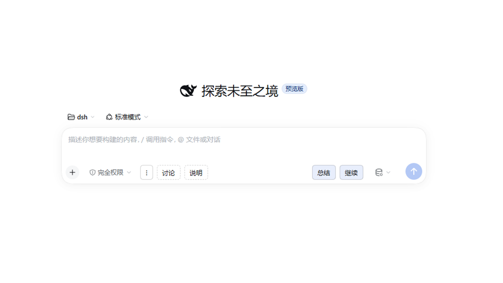
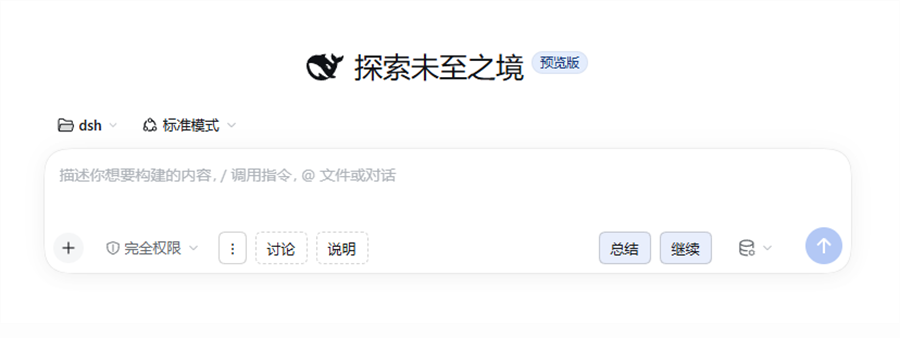
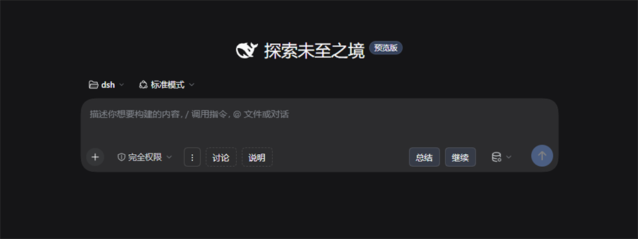
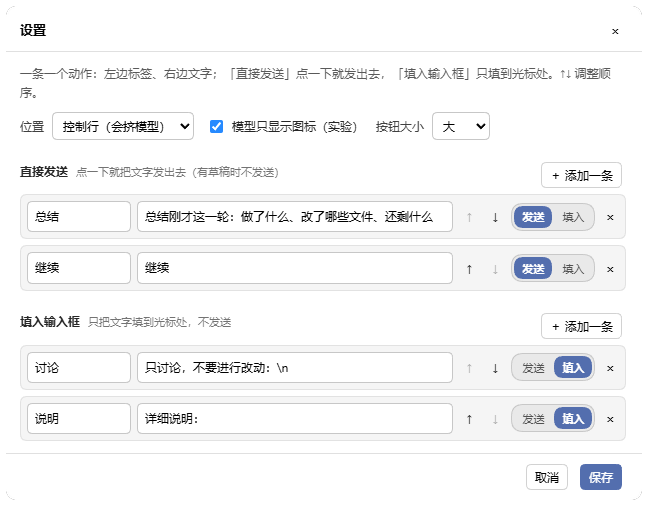

# dsh-button

在输入框下面加一排自定义按钮：**预设快捷输入**——把反复重打的常用语、提示词存成按钮，点一下填入草稿，或者直接发送。

按钮可调位置（左 / 右）、可调外观（浅底 / 主色 / 描边 / 警示），每侧超过 6 条自动收进可搜索的「⋯ 全部动作」。文字可以是固定的，也可以**点击时才读**：上一条我发的消息、当前草稿、当前选区（可套 `{{value}}` 模板）。



| 官方默认 · 浅色 | 官方默认 · 深色 |
|---|---|
|  |  |
| **示例皮肤 · 浅色** | **示例皮肤 · 深色** |
|  |  |

> 同一套按钮在官方默认和示例皮肤、浅色和深色下位置和行为都不变。
> 默认：左侧放「填入」类（描边），右侧放「发送」类（浅底实底）；位置和外观都能在设置里单独改。

## 安装

桌面端：**设置 → 插件 → 添加插件**，输入 `dsh-button`，装完重启 DSH。

或者用 CLI：

```powershell
dsh plugin --profile <你的profile> add dsh-button
```

从 GitHub 装也可以（钉在已发布的 `v1.3.0`）：

```powershell
dsh plugin --profile <你的profile> add github:xinming-chenniang/dsh-button#v1.3.0
```

`#v1.3.0` 不要省：不钉版本会取仓库的 `main`，那是 1.3.1 开发中的代码，行为和已发布版本不一致。

装完要重启 DSH。客户端插件是启动时加载的，刷新页面不会生效。

## 默认有什么

首次安装、还没有配置文件时，自带 5 个按钮：

| 标签 | 预设文字 | 方式 | 位置 | 外观 |
|---|---|---|---|---|
| 总结 | 总结刚才这一轮：做了什么、改了哪些文件、还剩什么 | 发送 | 右 | 浅底 |
| 继续 | 继续 | 发送 | 右 | 浅底 |
| 讨论 | 只讨论，不要进行改动：（并换行） | 填入 | 左 | 描边 |
| 说明 | 详细说明： | 填入 | 左 | 描边 |
| 解释 | `解释：` + 换行 + 选中的内容（来源「当前选区」） | 发送 | 右 | 浅底 |

「解释」是档 2 的示例：在输入框或聊天记录里选中一段，点它就把「解释：+ 选中内容」发出去。

最左边的 **⋮** 打开设置面板。

## 怎么用

**发送**：把文字放进输入框并提交。输入框里已经有草稿时不会发送，只提示「有草稿，未发送」，避免覆盖你写了一半的东西。

**填入**：只把文字插到光标处，不提交；有选区就替换选区，没有就插在光标处。多行文字也支持。

**Ctrl + 点击（macOS 上 Cmd + 点击）填入类按钮 = 直接发送**，不用先去设置里把它改成发送类。草稿保护照旧：有草稿就只提示，不会覆盖。

发送恒为排队（宿主 `submit()` 的行为）；手打 Enter 才受「繁忙时的发送行为」设置影响。

### 文字从哪来（来源）

每条按钮有一个**来源**，决定点一下时用哪段文字：

| 来源 | 点一下时读什么 | 典型用法 |
|---|---|---|
| 静态文字（默认） | 配置里写好的文字 | 常用语、提示词 |
| 上一条我发的 | 当前会话里最后一条你发的消息 | 「重发上一条」、基于上一条继续 |
| 当前草稿 | 输入框里现在写的内容 | 把草稿发出去、给草稿加前缀 |
| 当前选区 | 输入框里选中的文字，或页面上选中的历史对话 | 选中一段（输入框或聊天记录）→ 「解释这段：…」 |
| 上一条 AI 回答 | 当前会话里最后一条 AI 回复的正文（只收正文，不含思考/工具调用） | 「接着这条说：…」「总结上一条回答」 |
| 会话标题 | 当前会话标题（宿主没暴露就读不到） | 把会话标题带进提问 |
| 当前模型 | 当前会话的模型名 | 「这个回答太短，换模型重答」 |
| 当前时间 | 本地时间 `YYYY-MM-DD HH:mm` | 带时间戳的提示（会写死时间戳、破坏可复现，慎用） |

来源不是静态时，文字框变成**模板**（可选）：`{{value}}` 处插入读到的内容，留空 = 原样，模板里没有 `{{value}}` = 固定文字。例如选区来源 + `解释这段：\n{{value}}`。

- 「上一条我发的」只认真人输入（注入、引用、技能调用、压缩检查点都不算）；只发文本，附件/图片不会跟着复制。
- 「当前草稿」配「发送」= 直接提交草稿本身（草稿就是要发的东西，所以不触发「有草稿，未发送」的保护）；空草稿时提示「没有可用的内容」。
- 「当前选区」有两种位置：输入框里选中的文字会**精确替换选区**——模板留空 = 替换成它自己（看起来没变化），想有内容就写模板，如 `解释这个：\n{{value}}`；聊天记录里选中的文字（历史对话）只取文本，按方式插入到光标处或发送（发送仍走草稿保护）。
- 读不到内容（没有上一条 / 草稿是空的 / 没选区）时按钮不动作，只在按钮上浮一行「没有可用的内容」。
- 读取是只读的：不改会话记录、不改草稿、不出网。

### 换行和转义

在按钮文字里写：

| 写法 | 结果 |
|---|---|
| `\n` 或 `/n` | 换行 |
| `\t` 或 `/t` | 制表符 |
| `\\` | 一个反斜杠 |

只在执行时解码，编辑框里仍然显示 `\n` 这样的可读写法。建议用反斜杠形式：`/n`、`/t` 是全局替换，写在 `/tmp`、`/node_modules` 这类路径里会被误伤。

## 设置面板

点 **⋮** 打开「设置」：



### 改按钮

- 按钮分 **左侧 / 右侧** 两个区；行的顺序就是动作条上的顺序；
- 每行从左到右：`⠿` 拖动把手、标签、**来源**、文字（或模板）、外观下拉、方式（发送 / 填入）、`×`（删除）；
- 按住 `⠿` 拖动排序，拖到另一侧的分区就换区（插到目标行前、或该区末尾）；
- 改「发送 / 填入」**不会**换区——位置和动作是两件事；
- 每个区行列表的下方有「＋ 新按钮」（左对齐文字按钮，hover 才出浅底）；
- 改完点「保存」，或者点面板外面直接关掉（不保存）；保存失败的原因显示在底部常驻页脚，不会被滚动藏掉。

**拖动面板**：按住标题栏可以拖到任意位置（位置记在浏览器 localStorage），双击标题栏复位；拖过之后会出现 `⟲` 复位按钮，关掉面板再打开位置还在。

### 外观

每条按钮有一个外观（只影响长相，不影响点一下做什么）：

| 外观 | 样子 | 适合 |
|---|---|---|
| 浅底（默认） | 主色浅底 + 主色淡边 | 发送类 |
| 主色 | 主色实底白字 | 最常用的那一条 |
| 描边（默认） | 透明 + 中性细边、字略淡 | 填入类 |
| 警示 | 红色系 | 「别点错」的动作 |

外观只取宿主主题变量，深浅色和示例皮肤下自动适配。省略外观时按方式派生（发送 → 浅底、填入 → 描边）。1.3 的填入按钮是虚线，1.3.1 改成中性描边——虚线在规范里表示「占位 / 未完成」，用在动作按钮上容易被读成没做完。

### 换位置

设置里的「位置」有三项，切换立即生效（会关闭编辑器，未保存的修改会丢）：

| 位置 | 样子 |
|---|---|
| 控制行（默认） | 在输入框那一行，左右两格分别放左组/右组 |
| 卡片下方 | 在输入框卡片下面、统计行上面，整行 |
| 卡片底部 | 在输入框卡片内部底边 |

控制行模式会跟模型选择器抢位置，窄的时候模型会收成图标；这是这个位置本身的代价。

### 调大小

设置里的「按钮大小」有三档（高度按 Primer / Fluent 的控件阶梯 24 / 28 / 32 校准）：

- 紧凑 24px（左右内边距 8px、字号 12px）
- 标准 28px（默认；左右内边距 10px、字号 12px）
- 大 32px（左右内边距 12px、字号 13px、圆角 8px）

只影响动作条按钮；设置面板里的控件保持标准尺寸。选择记在浏览器 localStorage 里，不写配置文件。

### 模型只显示图标

设置里有一个「模型只显示图标（实验）」开关，**默认开启**：打开后强制模型选择器收起成图标；关掉则交还给宿主自动判断（窄的时候仍可能自动收起）。

它依赖宿主的内部 CSS 变量，DSH 升级后可能失效。失效的表现是模型文字重新出现，不影响按钮功能。

## 容量与搜索

- 上限 **40 条**（标签最多 12 字，不能换行；文字最多 500 字）；
- 动作条**每侧最多显示 6 条**，超出的收进「⋯ N」入口（N = 两侧合计溢出的条数，入口在左侧末尾）；
- 点「⋯」打开**全部动作面板**：搜索框按标签和文字过滤（不区分大小写），列出全部动作（包括已经显示在条上的），每条右边标着「发送 / 填入」；
- 点一条直接执行（Ctrl/Cmd 语义与条上按钮一致），执行后面板关闭；`Esc` 或点面板外关闭；
- 6 条以内不出现「⋯」，和 1.3 的行为完全一样。

## 配置

按钮存在这里：

```text
$DSH_HOME/dsh-button/buttons.json
```

Windows 默认是：

```text
C:\Users\<你>\.dsh\dsh-button\buttons.json
```

文件不存在时用默认 4 条；保存过一次后以文件为准。手动改完要重启 DSH。

```json
{
  "buttons": [
    { "label": "总结", "text": "总结刚才这一轮：做了什么、改了哪些文件、还剩什么", "mode": "send", "style": "secondary", "side": "right" },
    { "label": "继续", "text": "继续", "mode": "send", "style": "secondary", "side": "right" },
    { "label": "讨论", "text": "只讨论，不要进行改动：\\n", "mode": "insert", "style": "ghost", "side": "left" },
    { "label": "说明", "text": "详细说明：", "mode": "insert", "style": "ghost", "side": "left" }
  ]
}
```

字段：

| 字段 | 取值 | 省略时 |
|---|---|---|
| `label` | 1–12 字，不能换行 | 必填 |
| `text` | 1–500 字，可用 `\n` | 必填 |
| `mode` | `send` / `insert` | `send` |
| `source` | `static` / `last-user` / `last-assistant` / `draft` / `selection` / `session-title` / `model` / `time` | `static`（读配置里的 `text`） |
| `style` | `secondary` / `primary` / `ghost` / `danger` | 按 `mode` 派生 |
| `side` | `left` / `right` | 按 `mode` 派生（insert 左、send 右） |

- 在设置里删空并保存，就是真的没有按钮，不会回退默认。
- 路径可以用环境变量 `DSH_BUTTON_CONFIG` 改。
- 旧的 `icon` 字段（只存在于未发布的开发分支）读入时会并进标签，保存后不再写回。

### 从旧版本升级

从 **1.3.0** 升级：配置零改动。`style` / `side` / `source` 缺省时按 `mode` 派生或取 `static`，外观、位置与行为都和 1.3 一模一样。

从 **1.2.x** 升级，旧配置还能直接读：

- `presets.continue` 会并成第一条普通按钮；
- `hidden: ["continue"]` 仍然表示「这条已经迁移或删掉」，不会再补；
- `presets.resend` 会被忽略。

**「重发上一条」**不再内置：用「上一条我发的」来源建一条普通按钮即可（标签「重发」、来源「上一条我发的」、方式「发送」）。

## 限制

- 只处理文字：不执行命令、不读文件、不改 git，也不碰凭据。
- 来源（上一条 / 草稿 / 选区）只读不写：读不到内容时按钮不动作，提示「没有可用的内容」，不把空消息塞进会话。
- 来源读取依赖宿主公开面（`eventSource` / `draftSnapshot` / `caretSpan`）；宿主太旧、这些面缺失时同样按「没有可用的内容」降级，不会报错。
- 「上一条我发的」只取纯文本；附件、图片、引用不会随按钮复制。
- 发送有草稿保护；填入没有，它会按你的光标位置改草稿。
- 填入会替换当前选区；宿主太旧、没有 `insertText` 时退回「追加到草稿末尾」，状态会显示「已填入末尾」。
- 多行填入走宿主 `setDraft`，光标会落在草稿末尾。
- 控制行用的是公开插槽，最稳；卡片下方/底部依赖宿主 DOM，DSH 改结构后可能要重新适配。
- 动作条每侧只显示 6 条，「⋯」入口挂在左侧末尾；右侧溢出时也只能从这里打开全部动作。
- 面板位置、按钮大小、模型开关存在 localStorage，不跨浏览器/设备同步，也不进配置文件。
- 当前在 DSH `0.2.1-rc.2` 上测过。`package.json` 声明 `engines.dsh >= 0.2.0-rc.2`；更旧的宿主会缺填入 API，按上面的方式降级。

## 开发

```powershell
npm test
# 77/77
```

主要文件：

- `lib/client.js`：按钮条、设置面板、外观、容量面板、发送/填入；
- `lib/buttons.js`：配置读写、校验、默认按钮；
- `lib/index.js`：宿主路由 `/api/dsh-button/buttons`；
- `test/`：离线用例，不依赖桌面端。

没有构建步骤，Node >= 20。

## 卸载

插件管理器里移除，然后重启 DSH。

配置文件不会自动删；不需要就手动删掉 `$DSH_HOME/dsh-button/buttons.json`，删了会回到默认 4 条。

## 变更

看 [CHANGELOG.md](CHANGELOG.md)。当前版本 **1.3.1**（开发中，未发布；已发布的最新版是 1.3.0）。

问题反馈：[GitHub Issues](https://github.com/xinming-chenniang/dsh-button/issues)。MIT License。

## English

`dsh-button` adds a row of text actions to the DSH composer. Each button either sends a preset message or inserts it at the caret without sending; Ctrl/Cmd-click an insert button to send it instead. Buttons can sit on the left or right side, use one of four semantic looks (tint / solid / outline / alert), and up to 40 are supported — beyond 6 per side the rest go into a searchable "⋯ All actions" panel. Order, placement, size, and panel position are editable from the ⋮ settings panel; nothing else runs.
