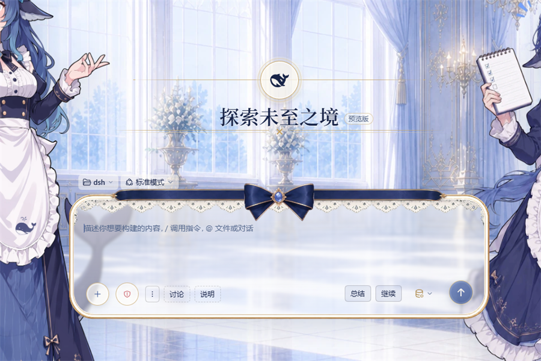
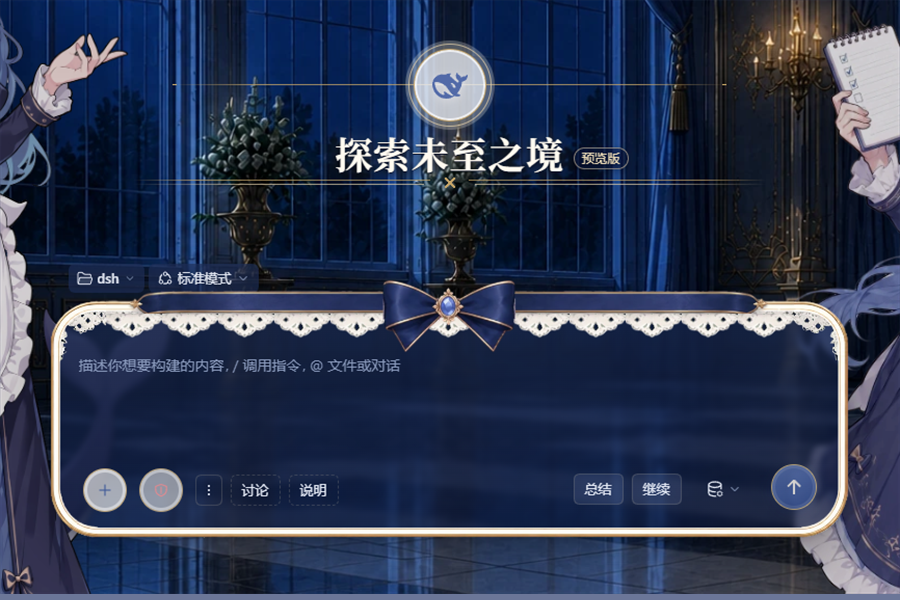

# dsh-button

在输入框下面加一排自定义按钮：**预设快捷输入**——把反复重打的常用语、提示词存成按钮，点一下填入草稿，或者直接发送。

| 官方默认 · 浅色 | 官方默认 · 深色 |
|---|---|
|  |  |
| **示例皮肤 · 浅色** | **示例皮肤 · 深色** |
|  |  |

> 同一套按钮在官方默认和示例皮肤、浅色和深色下位置和行为都不变。
> 左侧虚线是「填入」类按钮，右侧实底是「发送」类按钮。

## 安装

桌面端：**设置 → 插件 → 添加插件**，输入 `dsh-button`，装完重启 DSH。

或者用 CLI：

```powershell
dsh plugin --profile <你的profile> add dsh-button
```

从 GitHub 装也可以：

```powershell
dsh plugin --profile <你的profile> add github:xinming-chenniang/dsh-button
```

装完要重启 DSH。客户端插件是启动时加载的，刷新页面不会生效。

## 默认有什么

首次安装、还没有配置文件时，自带 4 个按钮：

| 标签 | 预设文字 | 方式 |
|---|---|---|
| 总结 | 总结刚才这一轮：做了什么、改了哪些文件、还剩什么 | 发送 |
| 继续 | 继续 | 发送 |
| 讨论 | 只讨论，不要进行改动：（并换行） | 填入 |
| 说明 | 详细说明： | 填入 |

最左边的 **⋮** 打开设置面板。

## 怎么用

**发送**：把文字放进输入框并提交。输入框里已经有草稿时不会发送，只提示「有草稿，未发送」，避免覆盖你写了一半的东西。

**填入**：只把文字插到光标处，不提交；有选区就替换选区，没有就插在光标处。多行文字也支持。

发送恒为排队（宿主 `submit()` 的行为）；手打 Enter 才受「繁忙时的发送行为」设置影响。

### 换行和转义

在按钮文字里写：

| 写法 | 结果 |
|---|---|
| `\n` 或 `/n` | 换行 |
| `\t` 或 `/t` | 制表符 |
| `\\` | 一个反斜杠 |

只在执行时解码，编辑框里仍然显示 `\n` 这样的可读写法。建议用反斜杠形式：`/n`、`/t` 是全局替换，写在 `/tmp`、`/node_modules` 这类路径里会被误伤。

### 改按钮

点 **⋮** 打开「设置」：


- 每行左边是标签，右边是文字；
- 「发送 / 填入」是二选一分段，点一下这条会移到另一个区；
- `↑` / `↓` 调整本区顺序；顺序就是配置文件里的数组顺序；
- `×` 删除；
- 每个区标题右边有「添加一条」；
- 改完点「保存」，或者点面板外面直接关掉（不保存）。

上限 8 条。标签最多 12 字，不能换行；文字最多 500 字。

### 换位置

设置里的「位置」有三项，切换立即生效：

| 位置 | 样子 |
|---|---|
| 控制行（默认） | 在输入框那一行，填入靠左、发送靠右 |
| 卡片下方 | 在输入框卡片下面、统计行上面，整行 |
| 卡片底部 | 在输入框卡片内部底边 |

控制行模式会跟模型选择器抢位置，窄的时候模型会收成图标；这是这个位置本身的代价。

### 调大小

设置里的「按钮大小」有三档：

- 紧凑 22px
- 标准 26px
- 大 30px（默认）

只影响动作条按钮；设置面板里的控件保持标准尺寸。选择记在浏览器 localStorage 里，不写配置文件。

### 模型只显示图标

设置里有一个「模型只显示图标（实验）」开关。打开后会强制模型选择器收起成图标；关掉则交还给宿主自动判断（窄的时候仍可能自动收起）。

它依赖宿主的内部 CSS 变量，DSH 升级后可能失效。失效的表现是模型文字重新出现，不影响按钮功能。

## 配置

按钮存在这里：

```text
$DSH_HOME/dsh-button/buttons.json
```

Windows 默认是：

```text
C:\Users\<你>\.dsh\dsh-button\buttons.json
```

文件不存在时用默认 4 条；保存过一次后以文件为准。手动改完要重启 DSH。

```json
{
  "buttons": [
    { "label": "总结", "text": "总结刚才这一轮：做了什么、改了哪些文件、还剩什么", "mode": "send" },
    { "label": "继续", "text": "继续", "mode": "send" },
    { "label": "讨论", "text": "只讨论，不要进行改动：\\n", "mode": "insert" },
    { "label": "说明", "text": "详细说明：", "mode": "insert" }
  ]
}
```

- `mode` 省略就是 `send`。
- 在设置里删空并保存，就是真的没有按钮，不会回退默认。
- 路径可以用环境变量 `DSH_BUTTON_CONFIG` 改。

### 从 1.2 升级

旧配置还能直接读：

- `presets.continue` 会并成第一条普通按钮；
- `hidden: ["continue"]` 仍然表示「这条已经迁移或删掉」，不会再补；
- `presets.resend` 会被忽略。

**「重发上一条」已经移除**。大多数情况可被继续代替。

## 限制

- 只处理文字：不执行命令、不读文件、不改 git，也不碰凭据。
- 发送有草稿保护；填入没有，它会按你的光标位置改草稿。
- 填入会替换当前选区；宿主太旧、没有 `insertText` 时退回「追加到草稿末尾」，状态会显示「已填入末尾」。
- 多行填入走宿主 `setDraft`，光标会落在草稿末尾。
- 控制行用的是公开插槽，最稳；卡片下方/底部依赖宿主 DOM，DSH 改结构后可能要重新适配。
- 当前在 DSH `0.2.1-rc.2` 上测过。`package.json` 声明 `engines.dsh >= 0.2.0-rc.2`；更旧的宿主会缺填入 API，按上面的方式降级。

## 开发

```powershell
npm test
# 47/47：客户端 33 + 宿主 14
```

主要文件：

- `lib/client.js`：按钮条、设置面板、发送/填入；
- `lib/buttons.js`：配置读写、校验、默认按钮；
- `lib/index.js`：宿主路由 `/api/dsh-button/buttons`；
- `test/`：离线用例，不依赖桌面端。

没有构建步骤，Node >= 20。

## 卸载

插件管理器里移除，然后重启 DSH。

配置文件不会自动删；不需要就手动删掉 `$DSH_HOME/dsh-button/buttons.json`，删了会回到默认 4 条。

## 变更

看 [CHANGELOG.md](CHANGELOG.md)。当前版本 **1.3.0**。

问题反馈：[GitHub Issues](https://github.com/xinming-chenniang/dsh-button/issues)。MIT License。

## English

`dsh-button` adds a row of text actions to the DSH composer. Each button either sends a preset message or inserts it at the caret without sending. Buttons, order, placement, and size are editable from the ⋮ settings panel; nothing else runs.
