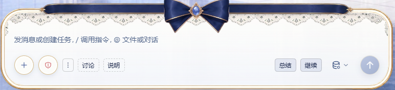

# dsh-button —— 输入框那一排的动作（独立插件）



## 快速开始

点输入框旁的三类按钮：

| 按钮 | 作用 |
|---|---|
| 继续 | 发送「继续」（标签和文字都能在编辑器里改） |
| 自定义 | 发送你配置的「标签 + 文字」 |
| 重发上一条 | 把最后一条本人消息原样再发一次 |

安装（桌面端）：**设置 → 插件 → 添加插件**，输入 `dsh-button`，装完**重启 DSH**。

CLI：`dsh plugin --profile <profile> add dsh-button`（把 `<profile>` 换成实际 profile 名）；
GitHub 源：`dsh plugin --profile <profile> add github:xinming-chenniang/dsh-button`。

> ⚠️ 输入框里已有草稿时，按钮**不会发送**，只提示「有草稿，未发送」；先发送或清空草稿再点。
> 忙时点击会排队（按钮恒为 `queue`），闲时直接发出；「重发上一条」会再提交一次最后一条本人消息。
> 配置在 `$DSH_HOME/dsh-button/buttons.json`；卸载见文末「卸载」。

## 背景与变更史（内部记录）

> **职责（2026-10-22）**：只做「输入框按钮」。**收尾自检在 `dsh-closeout`**（CLI + skill，无 UI），
> 本插件不调用它 —— 想一键触发就配一条自定义按钮。
> `dsh-open-at-last-input` 是另一个界面插件（会话落点），与本包不合并。
> **改名**：2026-10-21 由 `dsh-closeout-button` 改为 `dsh-button`；同日把**目录、profile
> （`dependencies` + `bundles`）、`node_modules` junction** 一并改成新名 —— 改名执行与回滚脚本、
> 计划依据留在本机记录（不进包）。**重启应用**才装载新名。
> **2026-10-22 v0.6**：**取消写死的「收尾」按钮**，换成**自定义按钮**（标签 + 任意文字，可一键调用
> skill / 命令 / 常用提示）；配置在宿主侧 JSON，点「＋」在浮层里编辑。需要「收尾」就加一条
> `收尾 = 收尾`。
> **2026-10-22 v0.7**：**删除「收口」**。它 spawn 外部 `closeout` CLI，对没装该 CLI 的用户是坏格子；
> 现在只剩"填字并提交"的动作，不带任何宿主命令。
> **2026-10-22 v0.8**：自定义按钮编辑器改成**表单**：一条两个输入框（标签 / 文字）+「添加一条」+ 删除，
> 不再要求 `标签 = 文字` 的行格式；标签里出现 `=` 也不再报错。
> **2026-10-22 v0.9**：**预设按钮也可删除**（继续 / 重发上一条）：编辑器里逐条「删除」，
> 删除即从插槽注销、不留空位，随时「恢复」；状态存在配置文件的 `hidden` 字段。
> **2026-10-22 v1.0**：**「按建议执行」并入「继续」**（两者对模型只是语气差别，历史使用 66:25），
> 预设只剩「继续」「重发上一条」；需要精确语义的用户可自建一条 `按建议执行 = 按建议执行` 的自定义按钮。
> **2026-10-22 v1.1**：**首次安装自带 5 条默认按钮**（总结 / 审查 / 测试 / 提交信息 / 解释报错），
> 全部是通用、只读或低风险动作；保存过一次配置后以文件为准（清空按钮 = 真的清空，不再回退默认）。
> **2026-10-22 v1.2**：**预设也按「标签＋内容」编辑**：「继续」的标签和发送文字都能改；
> 「重发上一条」只能改标签（内容永远是最后一条真人消息，属于动态动作）。

> **出处**：2026-10-19 本机 DSH 会话建的客户端插件（用户要求"别每次手打收尾"）；
> 2026-10-20 用户要求把「重发上一条」也并进来；同日再加「继续」—— 用户原话："大多数时候都要说继续、
> 按推荐执行、接受，能不能整成一个按钮，相当于下一步"；2026-10-22 用户要求"自定义按钮，
> 可以自己选择发送什么文字，方便一键调用各种 skill，并把写死的收尾按钮取消掉"，随后"删掉收口"、
> "把预设按钮重做成继续 + 重发" —— **两个预设 + 一格自定义**。
> **是什么**：DSH 的 Web 端插件。⓪ 点「继续」把「继续」两个字填进当前会话并提交 ——
> 这是"没异议、往下走"的**通用答复**（继续 / 按推荐执行 / 接受 / 好的 / 行，都点它，不用再挑词）；
> ① 点「自定义」格里自己配的按钮，把配置的文字填进当前会话并提交（标签如「收尾」「知识库」）；
> ② 点「重发上一条」把最后一条**真人**用户消息原样再发一条。
> **状态**：**可用（2026-10-22 v1.2：离线 27 例全过；宿主配置读写与路由有独立用例）**。
> **处置**：保留（插件源码统一根下的 `dsh-button/`，**git 仓库**，历史可回滚；
> desktop profile 以 `link:` 指向它）。
> **关联**：本机收尾工具 `sessions-closeout.mjs`（「收尾」自定义按钮常配的那条命令）·
> 本机工作区规则「会话收尾」。

## v0.4：多了「继续」

一句话需求：*"大多数时候都要说：继续、按推荐执行、接受——能不能整成一个按钮，
相当于下一步，没异议的时候就不用打字。"*

可行，而且**只是一个"替你打两个字"的按钮** —— 与「重发上一条」共用同一套"填草稿并提交"的逻辑，
差别只有文案与发出去的词：

```text
点「继续」 → composer.setDraft('继续') → composer.submit()
```

为什么是「继续」而不是「好的」/「接受」/「行」：agent 收到的都是同一件事
（"我同意，别问了，往下做"），但「继续」是这批词里**最没有歧义**的一个 ——
"接受""好的"在审批语境里才自然，"继续"在"接着写下去"与"按你说的做"两种语境都成立。
要换词只改 `lib/client.js` 的 `TRIGGER_CONTINUE` 一个常量。

同意类说法怎么分工（v1.0 起只有两个预设）：

| 你想说的 | 点哪个 | 实际发出去 |
| --- | --- | --- |
| 没异议，往下走 / 好的 / 接受 / 行 / 照刚才的建议做 | 「继续」 | `继续` |
| 这轮聊完了，收摊 | 自定义按钮（配 `收尾 = 收尾`） | `收尾` |

> 「按建议执行」在 v1.0 并入了「继续」：两者对模型只是语气差别（本机历史使用 66:25），
> 留着两个格子只会让人犹豫点哪个。确实需要硬锁定"刚给的建议"时，自建一条
> `按建议执行 = 按建议执行` 的自定义按钮即可。

## 自定义按钮（v0.6，v0.9 起预设也可删）

一格平铺 N 个自定义按钮，每个 = **标签** + **点一下要发送的文字**。适合把常用动作变成一键：
`收尾 = 收尾`、`知识库 = 用 knowledge-base 技能查一下我最近的对话`、`健康 = 读 health-assistant 技能再回答`。

**配置在哪**（按优先级）：

1. 环境变量 `DSH_BUTTON_CONFIG` 指向的 `.json`；
2. `$DSH_HOME/dsh-button/buttons.json`（默认 `C:\Users\<你>\.dsh\dsh-button\buttons.json`）。

文件不存在 = 自带 **5 条默认按钮**（不会自动建文件）；保存过一次后以文件为准（保存空列表 = 真的清空，
不会回退默认）。手写格式（`hidden` / `presets` 可省略）：

```json
{
  "buttons": [
    { "label": "收尾", "text": "收尾" },
    { "label": "知识库", "text": "用 knowledge-base 技能查一下我最近的对话" }
  ],
  "hidden": ["resend"],
  "presets": {
    "continue": { "label": "继续", "text": "继续" },
    "resend": { "label": "重发上一条" }
  }
}
```

`hidden` 是可删除的**预设**：`continue` / `resend`（分别对应继续、重发上一条）。
`presets` 是可编辑的预设文案：`continue` 的标签和文字都能改（改了就是发新文字）；
`resend` 只能改标签 —— 它的内容永远是"最后一条我发的消息原文"，是动态的。

**默认 5 条**（首次安装、还没有 `buttons.json` 时显示；都是通用动作，不绑定任何目录规范）：

| 标签 | 发送 |
|---|---|
| 总结 | 总结刚才这一轮：做了什么、改了哪些文件、还剩什么 |
| 审查 | 审查当前未提交的改动，指出 bug 和风险，先别改 |
| 测试 | 跑相关测试，失败就修，最后报告结果 |
| 提交信息 | 根据当前改动生成一条 commit message，先别提交 |
| 解释报错 | 解释这个报错的原因，给出修复步骤，先别动手 |

**在界面里编辑**：点「＋」打开浮层，分两区：

- **预设按钮**：也按「标签＋内容」显示。继续是两个输入框（标签 / 要发送的文字）；
  重发是标签输入框 + 只读说明「最后一条我发的消息（动态）」；每条右侧「删除」，删掉变「恢复」；
- **我的按钮**：每条一个**标签输入框**＋一个**文字输入框**，底部「＋ 添加一条」，每条右侧「×」删除。

保存即落盘。**不需要记格式、不用写 `=`**：只填一半的行才会报错并指明第几条；两栏都空的行自动跳过。
上限 **8 条**；标签 ≤ 12 字、文字 ≤ 500 字、标签不能换行（文字可以多行）。保存走
`POST /api/dsh-button/buttons`，读取走 `GET` 同路径；两者都只接受 loopback + 同源。

**边界**：

- 配置只决定"发什么字"和"藏哪个预设"，不执行命令、不读文件；点按钮仍走 `setDraft + submit`。
- 删预设是**真的注销插槽格子**（不是画成空），恢复时重新注册 —— 所以删完不会留下空位。
- 读不到配置（宿主路由不通 / 桌面端 `dsh-app://` 转发未验证）时：自定义格只显示「＋」，
  预设全部按默认显示，编辑器里贴出错误；保存也会失败。
- 配置文件是**唯一**会被本插件写入的文件；不碰凭据、不出外网。

## 它做了什么

```
点「继续」        → 取当前会话 → composer.setDraft('继续')       → composer.submit()
点「自定义按钮」  → 取当前会话 → composer.setDraft(配置的文字)   → composer.submit()
点「重发上一条」  → 取最后一条真人用户消息的文本 → composer.setDraft(文本) → composer.submit()
```

这些按钮都只是"替你打一段字并提交"。**按钮恒为排队**（宿主 `submit()` 默认 queue），
手打 Enter 才受「繁忙时的发送行为」设置影响；输入框有草稿时按钮不发送。用的全是宿主**公开服务**：

| 步骤 | API | 出处（装机插件/宿主包里的实测用法） |
|---|---|---|
| 注册按钮 | `ctx.slots.inject(SLOT, () => ctx.slots.register({name,id,order}, Component))` | `dsh-plugin-restart`（`sidebar.footer.action`） |
| 找当前会话 | `ctx.sessions.list.getSnapshot()`：先看 `state.current`，否则取 `byId` 里 `retainedBy.mainView > 0` 的那行 | `clearai-dsh` 的注释实测：新版 `SessionListState` **没有** `current` |
| 读历史消息 | `ctx.sessions.binding(id).eventSource.getSnapshot().entries`，条目形如 `{ event: { type, seq, time, data } }` | `@deepseek-ai/dsh-client-ui-chat` 的 `binding.eventSource`；`dsh-better-sidebar` 的 `user/message` 过滤 |
| 真人消息判据 | `event.type === 'user/message'` 且 `event.data.source.kind === 'user'` | `dsh-better-sidebar` 的 `isContextInjectionMessage` |
| 填并提交 | `ctx.get('conversation').input.for(scope).setDraft(text)` + `.submit()` | `@anionex/dsh-turn-rewind`、`dsh-better-sidebar` |

## 落点（两个插槽、三个格子）

`lib/client.js` 顶部：

```js
const SLOT_CONTINUE = 'conversation.input.left'   // 继续：输入框左侧工具区，order 4（最左）
const SLOT_CUSTOM   = 'conversation.input.left'   // 自定义按钮：同一个插槽，order 5（一格平铺 N 个）
const SLOT_RESEND   = 'conversation.input.right'  // 重发：主发送/暂停键左侧那一排，order 5
```

同一个 `list` 插槽里放多个按钮 = **多个格子**，所以每个都必须用自己的 id：
`dsh-button:continue`（继续）、`dsh-button:custom`（自定义）。
复用别人的 id 会顶掉那个格子
（宿主插槽目录的原话：*reusing a shipped id puts you in THAT cell and replaces it*）。
实测两种写法的差别就是"两个按钮"还是"一个按钮"—— `test/client.test.mjs` 里有专门断言。

`conversation.input.right` 是宿主 `conversation.composer.bar` 声明的 `list` 插槽，与模型选择、
activity、主键同处输入框右下，列表顺序由 `order` 决定。

| 想放哪 | 改成 | 是否已被装机插件验证 |
|---|---|---|
| 输入框左侧（继续 + 自定义默认） | `conversation.input.left` | ✅ 宿主 `composer bar` 的 list 插槽 |
| 发送/暂停键旁（重发默认） | `conversation.input.right` | ✅ 同上；紧邻主键 |
| 左侧栏底部 | `sidebar.footer.action` | ✅ `dsh-plugin-restart` / `dsh-session-manager` |
| 会话标题栏右侧 | `conversation.session.header.actions` | ✅ `dsh-turn-rewind` / `dsh-session-manager` |

改完要**重装/重启**（客户端模块是启动时快照）。

## 安装

### npm（web profile）

```sh
dsh plugin --profile web add dsh-button
```

装完**重启**（客户端插件是启动时快照）。

### GitHub 源

```sh
dsh plugin --profile web add github:xinming-chenniang/dsh-button
```

### 桌面端

桌面 profile 由应用独占管理，CLI 会被拒绝：`profile "desktop" is managed exclusively by the Electron application`（实测）。
用 **设置 → 插件 → 添加插件**，输入 `dsh-button`（或 GitHub 仓库地址），安装后重启应用。

### 本地源码

**设置 → 插件**（插件经理）→「安装」→ 选择**本机 clone 下来的 `dsh-button` 目录**，或用 `link:` 安装后重启。

### 信任披露

客户端注入 `slots` / `locale`；宿主半部注入 `webServer`，并**读写一个配置文件**
（`$DSH_HOME/dsh-button/buttons.json`，可用 `DSH_BUTTON_CONFIG` 改路径）。
不碰凭据、不出外网；除该配置文件外不写任何文件。

## 卸载

- 插件管理器 → remove → **重启 DSH**；
- 或从 profile 的 `dependencies` 与 `dsh.profile.bundles` 各删一行、删掉 `node_modules` 里的 junction，重启；
- `$DSH_HOME/dsh-button/buttons.json` 不会自动删除；不需要就手动删（删文件 = 回到默认 5 条）。

## 自检

```powershell
node --test test/client.test.mjs   # 15 例：三格 / 预设删除与改名 / 继续 / 自定义 / 重发 / 禁用态
node --test test/buttons.test.mjs  # 12 例：默认按钮 / 配置与 hidden / presets 校验 / 读 / 原子写 / GET+POST 路由 / 安全边界
node --check lib/client.js
node --check lib/index.js
node --check lib/buttons.js
```

## 兼容性

| DSH 版本 | 结果 |
|---|---|
| `0.2.1-rc.2` | 已测：插件 active，`/api/dsh-button/buttons` 返回 200；`npm test` 27/27 |
| 其他版本 | 未测；`package.json` 只声明 `engines.dsh >= 0.2.0-rc.2` |

## 已知边界

- **桌面端页面在 `dsh-app://` 下**：页面源不是 `http://127.0.0.1:<port>`，`/api/` 是否被该协议转发**未验证**。
  `GET/POST /api/dsh-button/buttons` 不通时，自定义格只显示「＋」，编辑器内贴出错误；两个预设照常工作。
- **没有宿主动作了**：v0.7 删掉「收口」后，本插件不再 spawn 任何命令、不读 git / 磁盘；
  它只做"填字并提交"。需要会话体检、git 检查或交接的，交给会话里的 agent / `dsh-closeout` CLI。
- **自定义按钮的上限**：8 条、标签 ≤ 12 字、文字 ≤ 500 字、标签不能换行；超限保存会被 400 拒绝。
- **自定义按钮不执行命令**：它只把文字填进输入框并提交；**按钮恒为排队**，手打 Enter 受
  `busyEnter` 设置影响；有草稿时不发送。配置本身读不到代码执行面。
- **界面是否出现只能人眼看**：离线用例覆盖注册、点击、配置读写，但"格子是否真的画在输入框上"
  需要重启应用后确认。

- **「继续」文案固定**：发出去的就是这两个字（`TRIGGER_CONTINUE`），全角、不带标点 —— 与手打文案相同；
  但按钮恒为排队，手打 Enter 受 `busyEnter` 设置影响。
  它就是"继续 / 按推荐执行 / 接受 / 好的"这一族说法的**统一出口**，改词只改那一个常量。
- **「收尾」不再是固定按钮**（v0.6 取消）：需要就配一条 `收尾 = 收尾` 的自定义按钮；触发词仍与
  `本机工作区「会话收尾」规则` 一致。
- **「按建议执行」不再是固定按钮**（v1.0 并入「继续」）：需要精确语义时配一条
  `按建议执行 = 按建议执行`；`TRIGGER_SUGGEST` 常量已删除。
- **它不替你判断"该不该收尾"**：只是把文字发出去，收尾流程里该跑的体检/报告由会话按约定做。
- **有草稿时不发送**：不再整段覆盖；按钮提示「有草稿，未发送」，先发送或清空草稿再点。
- **`submit()` 不存在的旧宿主**：自动降级成"只填草稿"，按钮上提示"已填入，按回车"。
- **重发只发文本**：附件、图片、引用不会随按钮复制；消息若只有附件没有文本，按钮禁用。
- **重发跳过注入消息**：`source.kind` 不是 `user` 的（引用、技能调用、压缩检查点等）不算"我发的消息"。
- **只读已加载窗口**：事件分页时取当前窗口里的最后一条；"上一条"总在窗口尾部，够用。
- **运行中可点**：重发会排队成下一条，状态显示「已排队 · 本轮结束后发送」，不阻塞当前轮次。
- **包名 = 模块 id = patch insert id，四处必须全等**：`package.json.name`、`lib/client.js` 里
  `__ModuleLoader__.load({ id })` 与 `NAMESPACE`、`lib/index.js` 的 `name`、`cordis.patch.yml` 的
  `insert.id`。**2026-10-20 实测事故**：只把包名从 `dsh-closeout` 改成 `dsh-closeout-button`、
  漏改客户端 id，loader 会认为 batch 里"没注册这个包"，**回落到单文件 URL 再执行一次**；第二次
  注册报 `duplicate factory registration for "dsh-closeout"`，整个 web boot 失败，桌面端弹
  "应用无法启动或已意外停止"（诊断日志 `%APPDATA%\@deepseek-ai\dsh-desktop\logs\crash-*-web-boot.log`）。
  改名时用 `grep dsh-closeout` 自查一遍，`test/client.test.mjs` 里"id 必须等于包名"的断言就是闸门。

## 验证纪律（2026-10-20 实测事故，别再犯）

- **不要在应用运行时改 `lib/client.js` 做反例**。客户端模块有重载机制：把 `id` 临时改成旧名
  跑测试、再改回，会让同一个 factory 在同一个 renderer 里**注册两次**，报
  `duplicate factory registration for "dsh-closeout"`，renderer 直接崩溃
  （`%APPDATA%\@deepseek-ai\dsh-desktop\logs\crash-*-renderer.log`）。本次就是我在反例验证时
  这么干，应用恰好正在运行，于是崩了一次；全新进程重启后恢复正常。
- **反例要作用在副本上**：把 `lib/client.js` 复制到 `tmp\` 下改名，让测试指向副本，
  永远不动正在被宿主监视的真实文件。
- **改完客户端源码要完全退出应用再启动**，不要依赖热重载；半途重载会留下旧注册，
  需要一次干净启动才清得掉。

---

[](https://github.com/deepseek-ai/deepseek-harness)
